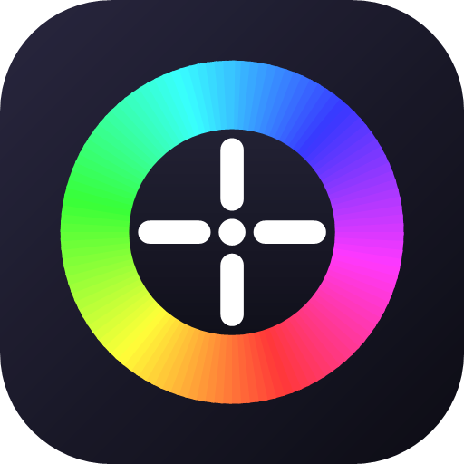
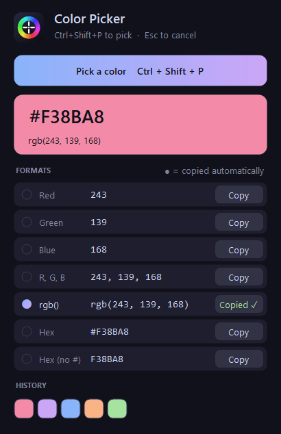

<p align="center">
  
</p>

<h1 align="center">Lightweight Color Picker</h1>

<p align="center">A tiny portable color picker for Windows. One <code>.exe</code>, no install.</p>

<p align="center">
  
</p>

## Features
- **Ctrl+Shift+P** starts picking. It works while the app is open, even if it isn't the focused window.
- While picking, a **magnifier follows your cursor** and shows the zoomed-in pixels plus the color under the cursor.
- **Click** anywhere to pick. The click is blocked, so nothing underneath gets clicked. **Right-click** or **Esc** cancels.
- Copy exactly the part you need: `R`, `G`, `B`, `R, G, B`, `rgb(R, G, B)`, `#RRGGBB` or `RRGGBB`.
- Click the dot next to a format to copy it **automatically** after every pick.
- **History** of your last 10 colors. Click one to load it again.
- Dark UI that works correctly on high-DPI and scaled displays.

## Download
Download [`ColorPicker.exe`](ColorPicker.exe?raw=true) and double-click it. It needs .NET Framework 4, which comes with Windows 10 and 11.

## Build it yourself
Uses the C# compiler that comes with Windows:

```powershell
& "$env:WINDIR\Microsoft.NET\Framework64\v4.0.30319\csc.exe" /nologo /target:winexe /optimize /win32icon:assets\icon.ico /out:ColorPicker.exe ColorPicker.cs Logo.cs
```

The icon and logo are drawn in code (`Logo.cs`). To regenerate them:

```powershell
& "$env:WINDIR\Microsoft.NET\Framework64\v4.0.30319\csc.exe" /nologo /out:MakeIcon.exe tools\MakeIcon.cs Logo.cs
.\MakeIcon.exe assets
```
